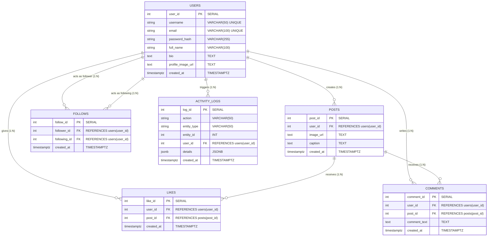

# SnapGrid - Entity-Relationship (ER) Diagram

This document presents the conceptual and logical Entity-Relationship model for **SnapGrid**, a mini Instagram clone database system. It highlights entities, attributes, primary keys, foreign keys, cardinality, and constraints.

---

## 1. Visual ER Diagram (Mermaid)

---

## 2. Entities and Attribute Definitions

### 2.1 USERS
*Represents registered platform members who can publish content and engage with the community.*
- **user_id (PK)**: Unique serial identifier automatically generated for each registered account.
- **username**: Unique handle selected by the user, constrained to 50 characters, non-nullable.
- **email**: Unique email address used for login and notifications, non-nullable.
- **password_hash**: Secure salted hash (e.g., bcrypt) protecting account authentication credentials.
- **full_name**: User's real or display name (up to 100 characters).
- **bio**: Free-form textual bio description for profile discovery.
- **profile_image_url**: Web address pointing to the user's avatar image.
- **created_at**: Timestamp with timezone recording account registration time.

### 2.2 POSTS
*Represents image-based visual updates shared by users.*
- **post_id (PK)**: Unique serial identifier for each post.
- **user_id (FK)**: References `users(user_id)`. The creator and owner of the post.
- **image_url**: Public or storage CDN URL of the uploaded image (mandatory).
- **caption**: Optional text accompanying the image.
- **created_at**: Timestamp when the post was published.

### 2.3 LIKES
*Associative entity resolving the Many-to-Many relationship between `USERS` and `POSTS`.*
- **like_id (PK)**: Unique serial surrogate key.
- **user_id (FK)**: The user who expressed appreciation.
- **post_id (FK)**: The post receiving the like.
- **created_at**: Timestamp of the interaction.
- *Constraint*: `UNIQUE(user_id, post_id)` ensures a user cannot like the same post more than once.

### 2.4 COMMENTS
*Represents conversational remarks left by users on posts.*
- **comment_id (PK)**: Unique identifier for each comment record.
- **user_id (FK)**: The author of the comment.
- **post_id (FK)**: The target post where the comment is posted.
- **comment_text**: Content of the comment (mandatory).
- **created_at**: Timestamp when the comment was recorded.

### 2.5 FOLLOWS
*Associative entity modeling directional social network edges (user following another user).*
- **follow_id (PK)**: Unique serial surrogate key.
- **follower_id (FK)**: References `users(user_id)` as the entity initiating the follow.
- **following_id (FK)**: References `users(user_id)` as the target profile being followed.
- **created_at**: Timestamp when the follow connection was initiated.
- *Constraints*:
  - `UNIQUE(follower_id, following_id)` prevents duplicate follow relationships.
  - `CHECK(follower_id != following_id)` prevents self-following.

### 2.6 ACTIVITY_LOGS
*Audit log entity capturing platform activity triggered by system events and database triggers.*
- **log_id (PK)**: Primary key for system audit records.
- **action**: High-level verb (e.g., `INSERT`, `UPDATE`, `DELETE`, `LIKE`, `COMMENT`).
- **entity_type**: Target domain entity affected (e.g., `'posts'`, `'comments'`, `'likes'`).
- **entity_id**: Identifier of the entity being acted upon.
- **user_id (FK)**: User who performed the action (nullable for system-level actions).
- **details**: Flexible `JSONB` document containing contextual change data or metadata.
- **created_at**: Timestamp when the event was audited.

---

## 3. Relationship Explanations & Cardinality

| Relationship | Entities Involved | Cardinality | Business Meaning & Rules |
| :--- | :--- | :--- | :--- |
| **Creates** | `USERS` &rarr; `POSTS` | **1 : N** (One-to-Many) | A user can create zero or many posts. Each post must belong to exactly one user (`ON DELETE CASCADE`). |
| **Gives Like** | `USERS` &rarr; `LIKES` | **1 : N** (One-to-Many) | A user can like zero or many posts. A single like belongs to exactly one user. |
| **Receives Like**| `POSTS` &rarr; `LIKES` | **1 : N** (One-to-Many) | A post can receive zero or many likes. A like is attributed to exactly one post. |
| **Writes Comment**| `USERS` &rarr; `COMMENTS` | **1 : N** (One-to-Many) | A user can author zero or many comments across the platform. |
| **Receives Comment**| `POSTS` &rarr; `COMMENTS`| **1 : N** (One-to-Many) | A post can receive zero or many comments. |
| **Follower Edge**| `USERS` &rarr; `FOLLOWS` | **1 : N** (One-to-Many) | A user can follow many other users (`follower_id`). |
| **Following Edge**| `USERS` &rarr; `FOLLOWS` | **1 : N** (One-to-Many) | A user can be followed by many other users (`following_id`). |
| **Triggers Action**| `USERS` &rarr; `ACTIVITY_LOGS`| **1 : N** (One-to-Many) | A user's activity triggers audit trail events stored in `activity_logs`. |

### Many-to-Many Resolutions
1. **Users & Posts (Likes)**:
   - Conceptual M:N relationship resolved via the associative table `likes(user_id, post_id)`.
2. **Users & Posts (Comments)**:
   - Conceptual M:N relationship resolved via `comments(comment_id, user_id, post_id, comment_text, created_at)`.
3. **Users & Users (Follows - Recursive / Self-Referential)**:
   - Conceptual M:N self-relationship resolved via `follows(follower_id, following_id)`.
