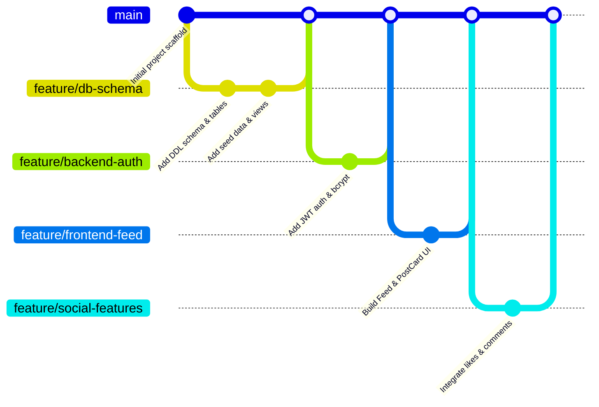

# SnapGrid - Team Contribution & Engineering Workflow

This document details the team member responsibilities, division of labor, Git branch management workflow, and collaboration standards for the **SnapGrid** DBMS project.

---

## 1. Team Members and Responsibility Matrix

| Team Member | Primary Engineering Role | Key Modules & Responsibilities | Core Deliverables |
| :--- | :--- | :--- | :--- |
| **Member 1** | **Database Architect** | - Relational Database Schema Design - ER Modeling & Normalization (UNF to BCNF) - PostgreSQL DDL Scripts & Constraints - Views (`post_statistics`, `user_statistics`) - Database Triggers (`activity_logs`) - Indexing & Query Optimization | `schema.sql` `seed.sql` `ER_DIAGRAM.md` `NORMALIZATION.md` `DBMS_CONCEPTS.md` |
| **Member 2** | **Backend Engineer (Core & Auth)** | - Express.js REST API Server Architecture - PostgreSQL Connection Pool Setup (`pg.Pool`) - User Authentication & Authorization (JWT & bcrypt) - User Profile Management APIs - Environment Configuration & Security Middleware | `server/index.js` `server/db/connection.js` `server/controllers/auth.js` `server/middleware/auth.js` |
| **Member 3** | **Frontend Engineer (UI/UX)** | - React Client Application Setup & Routing - Responsive Layout & UI Component Design - Authentication Screens (Login, Register) - Discovery Feed UI & Post Creation Dialog - User Profile View & Follower Counter Badges | `client/src/App.jsx` `client/src/components/*` `client/src/pages/*` `client/src/styles/*` |
| **Member 4** | **Full-Stack Integration & QA Lead** | - Social Interactions Integration (Likes, Comments, Follows) - End-to-End API Integration & State Synchronization - Comprehensive Test Plan & Edge Case Testing - API Documentation & Viva Preparation - Final Presentation Slides & Demonstration | `docs/API_DOCUMENTATION.md` `docs/TESTING.md` `docs/VIVA_QUESTIONS.md` `docs/README.md` Project Demo Deck |

---

## 2. Detailed Member Contributions

### Member 1: Database Architect
- Formulated the conceptual Entity-Relationship (ER) model and mapped entities to a 3NF/BCNF relational schema.
- Implemented PostgreSQL DDL scripts including constraints: `PRIMARY KEY`, `FOREIGN KEY ON DELETE CASCADE`, `UNIQUE`, `NOT NULL`, and `CHECK`.
- Engineered database views (`post_statistics`, `user_statistics`) to encapsulate complex aggregation queries.
- Authored PL/pgSQL database triggers (`log_post_activity`, `log_like_activity`) for automated audit logging into `activity_logs`.
- Created B-Tree performance indexes on foreign keys and timestamps for fast query execution.

### Member 2: Backend Core & Auth Engineer
- Configured Node.js and Express backend infrastructure with CORS, JSON body parser, and error-handling middleware.
- Established PostgreSQL connection pooling using `pg` driver with environment-based configuration.
- Built authentication endpoints (`/api/auth/register`, `/api/auth/login`, `/api/auth/me`) using `bcryptjs` and `jsonwebtoken`.
- Designed user profile management controllers and services (`/api/users/:id`, `/api/users/profile`).
- Implemented JWT token verification middleware protecting private routes.

### Member 3: Frontend Engineer
- Bootstrapped modern React client application with responsive desktop and mobile viewports.
- Developed UI components: `Navbar`, `PostCard`, `CommentList`, `UserProfileHeader`, and `Modal`.
- Built state management for authentication tokens and user sessions using React Context and LocalStorage.
- Integrated feed rendering with asynchronous data fetching, error handling, and optimistic UI updates.
- Styled consistent aesthetic matching modern social media application interfaces.

### Member 4: Full-Stack Integration & QA Lead
- Integrated social action endpoints (`/api/posts/:id/like`, `/api/posts/:id/comments`, `/api/users/:id/follow`) with client-side reactive buttons.
- Conducted exhaustive constraint violation and authorization security testing.
- Created technical documentation: API specifications, relational schemas, viva preparation questions, and test plans.
- Produced video demonstration and project presentation walkthrough for academic evaluation.

---

## 3. Git Workflow & Collaboration Protocol

The project followed a standardized GitHub flow featuring protected branches, descriptive commit messages, and peer code reviews.

### 3.1 Branch Naming Conventions
All branches were branched off `main` and adhered to the following standard naming format:

| Type | Format | Example |
| :--- | :--- | :--- |
| **Feature** | `feature/<module-name>` | `feature/db-schema` `feature/auth-jwt` `feature/post-comments` |
| **Bugfix** | `bugfix/<issue-description>` | `bugfix/like-count-mismatch` `bugfix/jwt-expiration-handler` |
| **Documentation** | `docs/<doc-name>` | `docs/er-diagram` `docs/viva-prep` |
| **Testing** | `test/<test-suite>` | `test/constraint-violations` `test/api-load` |

### 3.2 Commit Message Standard
Commit messages used Conventional Commits format:
- `feat(db): create triggers for activity audit logs`
- `feat(auth): implement bcrypt password hashing and jwt generation`
- `fix(feed): resolve left join bug omitting posts without comments`
- `docs(readme): add step-by-step windows setup guide`

### 3.3 Pull Request & Merge Policy
1. No direct commits to `main`.
2. Each pull request (PR) required review from at least one other team member.
3. Database changes had to be verified in local PostgreSQL before merging to ensure migrations executed cleanly.
